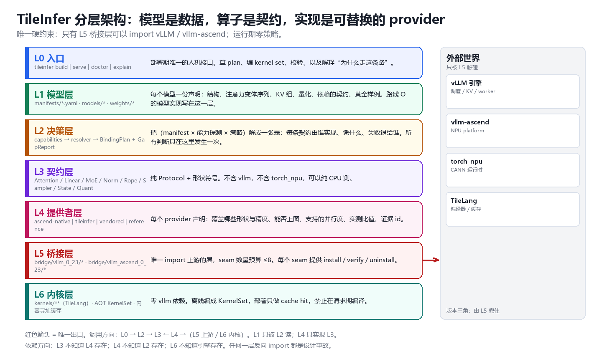
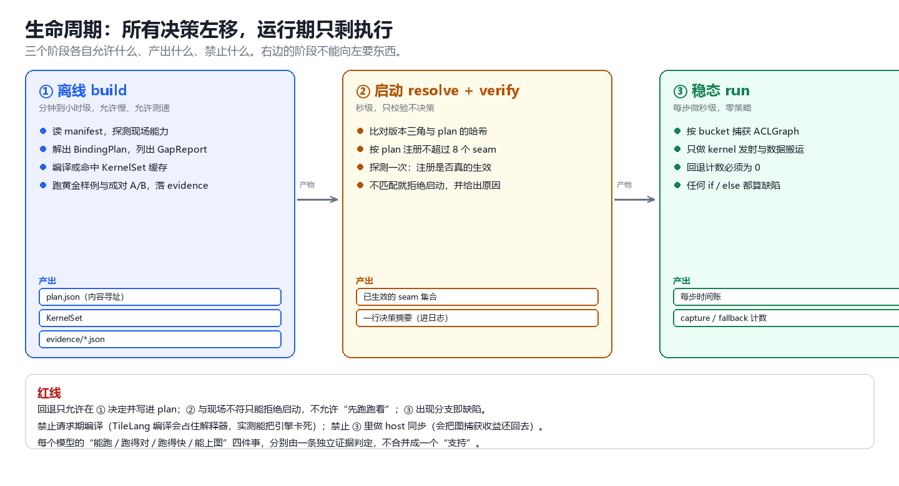

# 架构

> 本文写**目标形态**；现状见 [`status.md`](status.md)。两者不一致时以 status.md 为准，
> 并在 status 里记下差在哪一格。
>
> 本文不含代码细节。函数名、API 名、目录里的具体文件名，都故意不写——它们会随上游版本变，
> 写进来就等于让这份文档每季度作废一次。

---

## 1. 定位与演进

同一份代码，定位改过两次。这张表是为了**不再改第三次**——每次改动都是有代价的，代价写在最后一列。

| | 依赖关系 | 做法 | 付了什么代价 | 结论 |
|---|---|---|---|---|
| **v1 寄生** | 依赖 vllm-ascend | 在 vllm-ascend 里加一个注意力后端 + 若干算子补丁 | 短上下文与基线打平（0.91–1.09），但补丁点散落十几处，升级就得全量复核 | 能力对，形态不对 |
| **v2 原生** | **不依赖** vllm-ascend | 自己写平台层、worker、KV 池、attention 后端，只依赖 vLLM | 自由了，但**把别人的活重做了一遍**：TPOT 2.53×、TTFT 11.8×，图捕获仍未接上 | 形态纯粹，代价付不起 |
| **v3 兼容层**（当前） | 依赖 vllm-ascend | 平台/worker/显存/KV/图捕获**全部交给 vllm-ascend**；我们只做"选择"和"补齐" | 被上游版本绑住；要用 seam 预算和版本门管住 | 唯一能同时做到"能跑"和"不更慢"的形态 |

**v3 的赌注**：把"重写平台层"的力气，换成"适配更多模型"。理由是 v2 已经把答案写在数字里——
平台层重写不动性能；而 vllm-ascend 没适配的模型是一块真实的需求。

---

## 2. 目标与非目标

**目标**（可判定，口径见 [`acceptance.md`](acceptance.md)）

1. **G1 能部署的模型数**：新模型上线的边际成本 = 一份声明 + 缺口清单；缺口数决定工作量。
2. **G2 不比基线慢**：与同条件 vllm-ascend 基线比，TPOT / TTFT / 吞吐在门槛内。
3. **G3 跑得对**：每个模型有独立的对数证据，不靠"能出字"。
4. **G4 稳态零策略**：每步没有分支、没有查表、没有主机侧同步。
5. **G5 失败可定位**：任何一次失败能指到具体一层。

**非目标**

1. 不做另一个推理引擎（不重写平台、worker、调度、KV 管理）。
2. 不做编译器、不做新 IR。
3. 不做单进程多模型共存（一个进程一个模型，多模型＝多进程）。
4. 不做量化方案的全覆盖；按需、按模型，未验证就不声明支持。

---

## 3. 分层

| 层 | 职责 | 它**不知道**什么 | 现状 |
|---|---|---|---|
| **L0 入口** | 部署期唯一的人机接口：算计划、编内核、校验、解释"为什么走这条路" | 内核怎么写 | 🟡 只有剖析工具的雏形 |
| **L1 模型层** | 每个模型一份**声明**（结构、注意力变体序列、KV 分组、量化、依赖的能力、基准样例）；上游没有的模型实现也在这里 | 谁来提供实现 | 🟡 有模型实现，没有声明 |
| **L2 决策层** | 把（声明 × 现场能力 × 策略）解成一张计划表 + 一份缺口清单 | 实现长什么样 | 🟡 有候选机制的雏形 |
| **L3 契约层** | 8 类能力契约（注意力 / 线性 / MoE / 归一化 / 旋转 / 采样 / 状态 / 量化），纯接口 | 引擎、NPU、模型名 | 🟡 注意力已有 plan/run 契约 |
| **L4 提供者层** | 四种来源的实现：厂商原生 / 自研 / 引入 / 参考；每个声明覆盖范围、是否可上图、并行度、实测比值、证据 | 决策、引擎 | 🟡 有算子族，无声明与账本 |
| **L5 接入层** | 唯一允许 import 上游的层；把计划翻译成"替换哪张注册表、包装哪个方法" | 模型、策略 | 🟡 v1 插件冻结在 legacy/，v2 平台层待拆 |
| **L6 内核层** | 内核 + 预编译内核集 + 内容寻址缓存 | 引擎、契约 | ✅ 四族内核已建，预编译未做 |

**为什么是这个切法**：不是为了好看，是为了**测得住**。L3 能在没有卡的机器上跑单测；
L2 能凭声明和"假能力"算出完整决策；L5 是唯一会因上游升级而改动的目录，改动范围被物理限制住。
把"必须上卡才能发现的问题"压到最少，这是分层的全部价值。

---

## 4. 生命周期

| 时点 | 允许 | 产出 | 禁止 |
|---|---|---|---|
| **① 离线构建** | 慢、测速、编译、跑基准 | 计划文件（内容寻址）、预编译内核集、证据 | 依赖"现场刚好有某个包" |
| **② 启动** | 秒级校验、按计划替换注册表 | 已生效的接入点 + 一行决策摘要 | 决策；"先跑跑看" |
| **③ 稳态** | 内核发射、数据搬运、图回放 | 每步时间账、捕获/回退计数 | 任何分支、编译、主机侧同步 |

**"离线"不是后台自动跑**，而是"不在请求路径上"。它有三种合法落点：CI/开发机、
镜像构建期（推荐）、交付时一次性执行。三者都必须由显式动作触发，有开始、有结束、有产物。

**启动期只做两件事**：校验（计划文件与现场是否一致）和落表（按计划替换注册表）。
不一致就**拒绝启动并说明差异**，不允许带着不一致跑。

---

## 5. 两条路线

判据只有一句：**缺的是"实现"还是"模型"**。

| 路线 | 什么时候走 | 做什么 | 成本 |
|---|---|---|---|
| **U（上游模型 + 我们的实现）** | 上游有这个模型类，只是慢或某几处不能用 | 只补实现提供者（含注意力变体） | = 缺口数 |
| **O（我们自己的模型）** | 上游根本没有这个模型，或那份实现不可用 | 对着 L3 契约写模型结构，算子仍走统一提供者 | 模型结构 + 缺口 |

**为什么必须承认两条路线**：想用一个机制统一，就会退化成"每个模型一个补丁"——也就是 v1 的形态。

**上线一个新模型的固定动作**：写声明 → 出缺口清单 → 补缺口 → 离线构建 → 四道门
（能跑 / 跑对 / 能上图 / 跑快）→ 落证据 → 状态改为在役。
**没有证据的模型不许标在役。**

---

## 6. 五条不变量

| # | 不变量 | 破了会怎样 |
|---|---|---|
| **I1** | **单向依赖**：L3 不知道 L4，L4 不知道 L2，L6 不知道引擎；只有 L5 碰上游 | 任何一处反向依赖都会让"可测性"消失，最后只能上卡排障 |
| **I2** | **决策只发生一次**：决策是纯函数，输出内容寻址的计划文件 | 同输入出不同结果，就没法复现、没法 A/B、没法回滚 |
| **I3** | **稳态零策略**：形状相关选择在构建期固化成桶 | 分支进热路径，图捕获失效，性能当场还回去 |
| **I4** | **回退必须显式**：缺提供者要出缺口清单，降级要写进计划与日志 | 静默回退是这类层的头号事故源，且**只表现为变慢** |
| **I5** | **每层可单独删除**：提供者与接入点都能卸载；目标是把能力上游化之后删掉自己的 | 只增不减，维护成本线性上涨，最后被版本拖死 |

---

## 7. 硬约束（每条都能变成检查）

1. **不重写平台层**。设备、worker、显存、KV 池、图捕获的归属只有 vllm-ascend。
2. **接入点预算：6 个机制，上限 8 个**。超了必须写例外说明并重新设计。
   按机制数是 6（实现替换、方法包装、模型替换、注意力后端选择、入口加载、图捕获钩子）；
   按"对象"数会更多，但同一机制接管多少个对象不增加成本。
3. **不改上游源码**。只允许：安装期注册入口、启动期替换注册表、包装方法。
   一旦需要改文件，说明接错了位置。
4. **版本三角锁定**：引擎 / 平台 / 运行时三者的版本组合写进计划文件；不匹配就拒绝启动。
5. **禁止请求期编译**。编译产物必须来自离线构建；运行期只允许命中缓存。
6. **禁止静默回退**。回退要计数、要进日志、要能被测试断言为"不允许发生"。
7. **单一真相**：每个模型只有一份声明；每个决策只有一个产物。文档描述的目录必须真实存在。
8. **证据分级**：数字必须能追到一次可复现的运行；跨窗口的测量不当结论。

---

## 8. 能力边界（当前）

| 维度 | 现在能到什么程度 | 说明 |
|---|---|---|
| 注意力变体 | 全注意力（GQA/MQA）+ 线性注意力（GDN）已通 | 变体按"风味 × 批语义 × 布局"计，不按模型计 |
| 批语义 | 单 query token（纯解码）；预填充已能在引擎内接管 | 混合批、投机解码未做 |
| KV 形态 | 混合 KV（两种池同进程）已通 | 不同 KV 规格家族需要各自的声明与约束 |
| 量化 | 只做 bf16 一条路 | 未验证的组合一律不声明支持 |
| 并行 | 单卡 | TP/EP 明确延后 |
| 图捕获 | 引擎内跑过（v1 时代），v2 未接 | 稳态零策略是所有后续工作的前提 |

---

## 9. 参考设计（我们借了什么）

| 来源 | 借的是 | 没借的 |
|---|---|---|
| **vLLM 官方扩展点** | 接入不靠改源码，靠注册表与方法包装 | — |
| **设备驱动模型** | 声明 ≈ 设备树，能力探测 ≈ 探针，决策 ≈ 匹配，提供者 ≈ 驱动 | — |
| **PJRT / XLA** | "能力探测 → 编译产物 → 执行句柄"三段分离 | 代码生成 |
| **zml** | 生命周期分阶段、每阶段产物类型化、平台选择前移到构建期、形状用符号表达 | **不学它自拥模型层**——我们无法要求上游用我们的语言写模型 |
| **optimum-habana** | 维护"已验证模型台账"；配置对象集中化 | **不学它打模型补丁**——它 2026-10 停服，说明"补丁数量决定寿命" |
| **TVM** | 一份目标描述 + 统一选择流程 | 编译流水线 |

---

## 10. 待定

1. 首批锚点模型（决定路线 U/O 的具体对象与缺口清单）。
2. 注意力后端的接入口：包平台方法，还是注册一个自定义后端再让平台选它。
3. 计划文件的字段冻结时点（一旦对外就不好改）。
4. `legacy/` 里的 v1 插件是"直接升格"还是"照着重写"。
